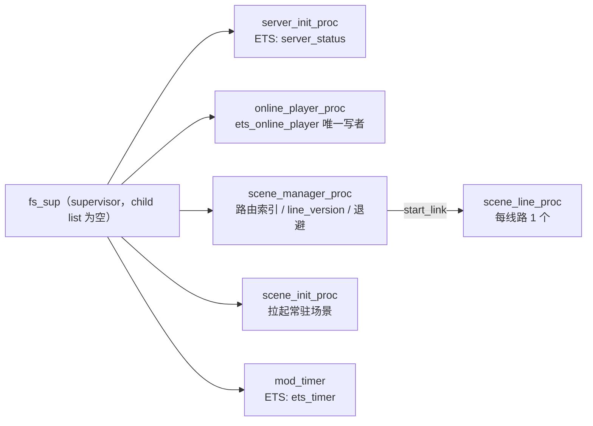
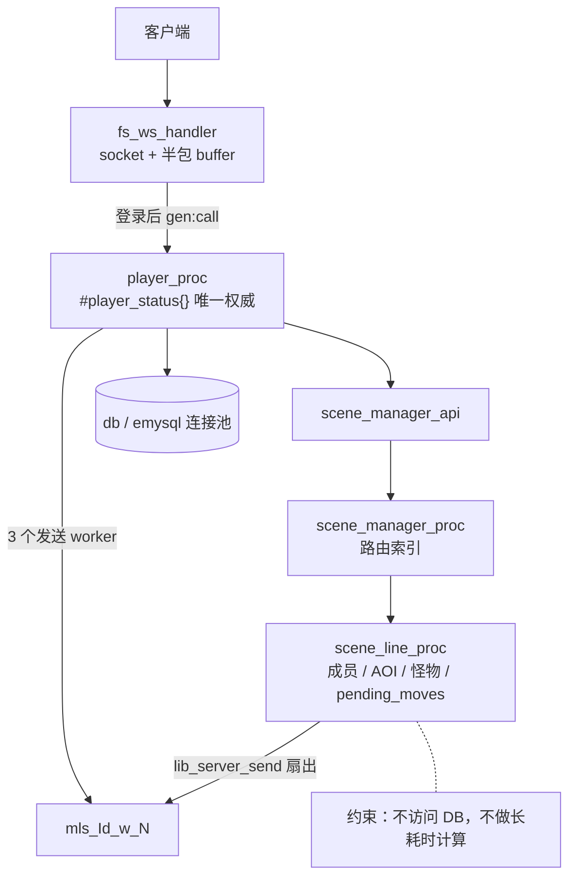
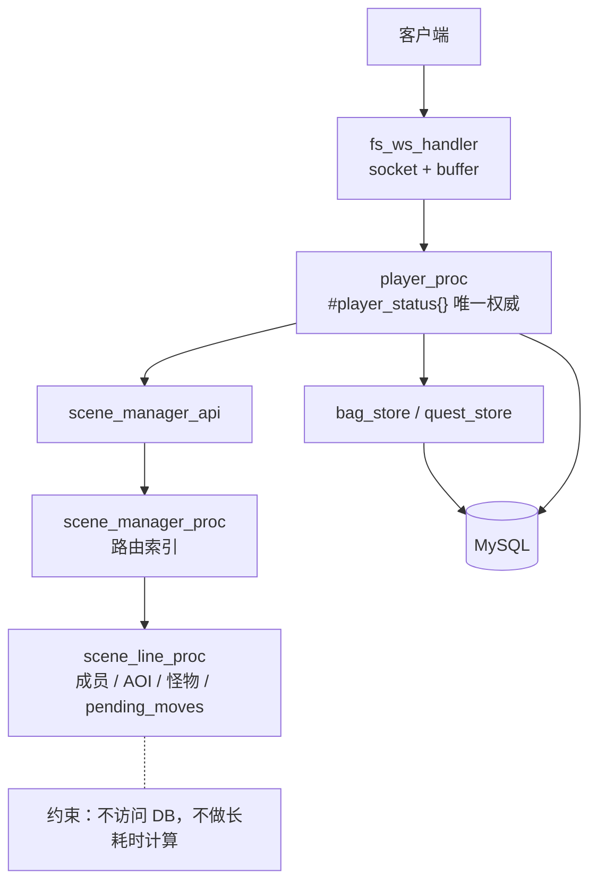
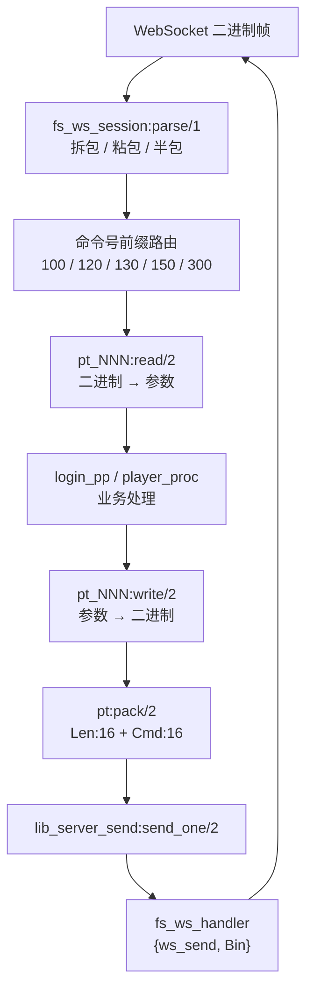
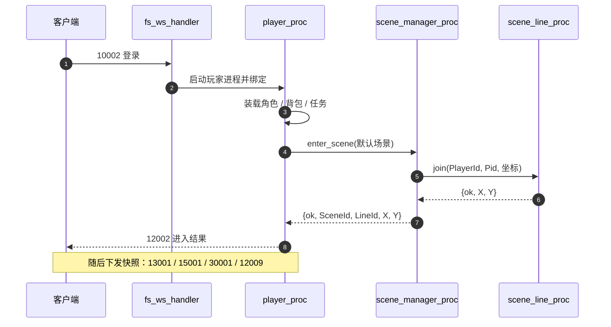

> 这是一份工程说明，不是产品宣传。文中每个数字都来自仓库内的验收报告；没有测量过的部分一律标注“未验证”，也不做容量外推。

写它的动机很简单：当系统从“能跑”走向“能被别人接手”时，真正需要解释的不是用了什么框架，而是**状态放在哪、谁有权改、重复请求怎么办、失败之后会丢什么**。这四件事决定了系统在压力下和故障中的行为。

| 项 | 值 |
| --- | --- |
| 版本 | v0.1（定稿） |
| 日期 | 2026-11-12 |
| 适用代码 | `fs` 0.1.0，单节点 |
| 测量基线 | T07（200 CCU 回归基线）、T20（2,000 CCU 容量报告） |
| 文档性质 | 工程说明，不含宣传性结论；未测量项一律标注“未验证” |

## 0. 摘要

- 服务端采用“每连接一进程、每玩家一进程、每线路一进程”的 Erlang/OTP 结构。玩家状态唯一权威在 `player_proc`，场景公共状态唯一权威在 `scene_line_proc`，`scene_manager_proc` 只持有路由索引。
- 协议是 4 字节固定头：`Len:16 + Cmd:16`，单包体上限 65,531 字节。解析器、编码器与客户端契约都按这一格式对齐。
- 四个关键决策分别是：线路状态单写者（D1）、16 位包长（D2）、线路运行态不落库（D3）、分层 OpId 幂等（D4）。它们分别收敛并发写、帧开销、恢复复杂度和重复结算风险，但每一个都有明确的失效边界。
- 已测：2,000 在线（20 秒登录 ramp）下登录 P95 252.6 ms、成功率 100%、tick 平均 57.5 ms / P99 100.6 ms、RSS 566.6 MB，通过容量门禁（证据 A）。
- 登录是当前第一个非线性瓶颈：2,000 同时登录 P95 为 10.9–12.4 秒，当时服务端 CPU 仅 16–20%，瓶颈在 DB 连接池与登录装载排队（证据 A）。
- 2,000 CCU 通过不等于 10,000 CCU 可承载。本文不外推，也不提供未经测量的容量承诺。

## 1. 范围、口径与证据等级

### 1.1 在范围内

- 单节点运行时的进程结构、监督关系与启动顺序。
- 玩家、线路、管理器三层的状态归属与唯一写者约束。
- WebSocket 帧到业务处理的协议分层、帧格式与解析边界。
- 场景进入/切换、移动合并、攻击结算三条关键路径。
- 四个关键设计决策的取舍与失效边界。
- T07 与 T20 两份实测数据的引用与读法。

### 1.2 不在范围内

- 10,000 CCU、多节点、多线路、跨服。
- 真实网络、真实客户端、真实玩家行为。
- 长稳、GC、内存泄漏、MySQL 故障切换。
- 产品 SLO 承诺、商业容量承诺、宣传性表述。

### 1.3 证据等级

| 等级 | 含义 |
| --- | --- |
| A | 有原始数据、脚本与报告，可按文档复现 |
| B | 有实测，但样本小或只覆盖单次运行 |
| C | 由代码、提交历史或设计文档直接推出，未单独测量 |
| D | 未验证；文中显式标注 |

正文中的“（证据 A/B/C/D）”均指此表。凡未标注的定性描述，属于设计意图而非测量结论。

## 2. 运行时结构

### 2.1 启动顺序

`fs_app:start/2` 依次执行：

1. `mod_time:init()`
2. `fs_sup:start_link()`
3. `db:start()`
4. `fs_game:start(Port)`

`fs_game:start/1` 先调用 `fs_server:start/0`。`fs_server` 是启动编排函数而不是进程：它把 `?SUP_CHILD_LIST` 里的五条 child spec 交给 `lib_game:start_child/1`，后者逐个执行 `supervisor:start_child(fs_sup, ChildSpec)`。

挂载顺序即列表顺序：

1. `server_init_proc`（创建 `server_status` ETS）
2. `online_player_proc`（`ets_online_player` 的唯一写者）
3. `scene_manager_proc`（路由索引）
4. `scene_init_proc`（拉起常驻场景）
5. `mod_timer`（创建 `ets_timer`）

五个进程挂载完成后，才启动 Cowboy 监听器 `fs_ws:start/1`。因此客户端可以登录时，场景管理器和常驻场景已经就绪。

两个容易踩错的点：

- `fs_sup:init/1` 返回空 child list。新增单例服务应扩展 `apps/fs/src/sys/fs_server.erl` 中的 `?SUP_CHILD_LIST`，而不是修改 `fs_sup`。
- Ranch listener 属于 `ranch_sup`，不属于 `fs_sup`；`fs_app:stop/1` 会显式停止它。

### 2.2 进程与监督结构



图 1：监督结构。`fs_sup` 的 child list 为空，五个长期进程由 `fs_game:start/1` → `fs_server:start/0` 在启动时逐个 `supervisor:start_child/2` 挂载；`scene_line_proc` 由 `scene_manager_proc` 以 `start_link` 拉起，不是 `fs_sup` 的监督子进程。



图 2：连接绑定与请求路径。`fs_ws_handler` 属于 `ranch_sup`，不在 `fs_sup` 下；线路只向发送 worker 投递，不直接写 socket。

### 2.3 状态归属

| 组件 | 粒度 | 持有的状态 | 生命周期 | 谁可以修改 |
| --- | --- | --- | --- | --- |
| `fs_ws_handler` | 每连接 | socket、收包 buffer、`#player{}` | 连接建立到关闭 | 仅自身进程 |
| `player_proc` | 每在线玩家 | `#player_status{}`：HP/属性、背包、任务、场景与坐标、`enter_ops` | 登录到登出 | 仅自身 `gen_server` 调用 |
| 发送 worker | 每玩家 3 个 | 出站队列 | 随玩家进程 | `lib_server_send` |
| `online_player_proc` | 单例 | `ets_online_player` 唯一写者、玩家 monitor 与 60s 巡检 | 全服 | 仅自身；读直接查 ETS |
| `scene_manager_proc` | 单例 | `{SceneId,LineId} => Pid`、`PlayerId => {SceneId,LineId}`、`line_version`、退避计数 | 全服 | 仅经 `scene_manager_api` |
| `scene_line_proc` | 每线路 | 成员表、AOI、怪物运行态、`pending_moves`、统计 | 线路创建到崩溃 | 仅 `scene_manager_proc` 与 `mon_api` 转发 |
| `scene_init_proc` | 单例 | 常驻场景启动清单 | 全服 | 仅自身 |
| MySQL | 外部 | 玩家持久数据、背包、任务、`bag_op` | 跨重启 | `player_proc` / `bag_store` / `quest_store` |

图 3：状态归属与唯一写者。实线是允许的调用方向，虚线是禁止方向。



### 2.4 边界规则

- 场景成员与 AOI 的变更只能走 `player_proc → scene_manager_api → scene_manager_proc → scene_line_proc`。业务模块不得直接改线路状态或绕过管理器索引。
- 玩家在线状态的唯一权威在 `player_proc`；`scene_line_proc` 只保存轻量 `#scene_player{}`（`player_id`、`pid`、`sid`、`x`、`y`），不复制整份玩家状态。
- 场景进程不访问 DB，也不做长耗时计算，避免 mailbox 堆积（设计文档 2.1、2.2、14.2）。
- 跨领域单例使用 ETS，并由 owner 创建：`server_init_proc` 创建 `server_status`，`mod_timer` 创建 `ets_timer`。
- 旧 `scene_proc` 仍保留在仓库，但不再承载线路状态；新增线路逻辑不要放入其中。

## 3. 协议分层

### 3.1 分层与数据流



图 4：协议分层。入站与出站共用同一套 4 字节头定义。

### 3.2 帧格式

```text
+--------+--------+------------------+
| Len:16 | Cmd:16 | Body (Len - 4)   |
+--------+--------+------------------+
```

- `Len` 是包含 4 字节头在内的总长度，因此 `BodyLen = Len - 4`。
- `Cmd` 为 16 位无符号命令号。
- 单包体上限为 `65,535 - 4 = 65,531` 字节。

解析器（`apps/fs/src/sys/ws/fs_ws_session.erl`）的行为：

- 不足 4 字节：整体留在 buffer，等待下一帧。
- `BodyLen < 0`：返回 `{error, {bad_length, Len}}`。
- 一个 WS 帧内可以包含多个完整包，解析器循环拆出，尾部不完整部分留在 buffer。
- 解析器还保留了一个 1 MB 的 `packet_too_large` 守卫；但 `Len` 只有 16 位，这个分支实际不可达（证据 C）。真正生效的上限是 65,531 字节。

编码器（`apps/fs/src/pt/pt.erl`）：

```erlang
pack(Cmd, Data) when is_integer(Cmd), Cmd >= 0, Cmd =< 65535, is_binary(Data) ->
  L = byte_size(Data) + 4,
  <<L:16, Cmd:16, Data/binary>>.
```

### 3.3 入站与出站

入站：

1. `fs_ws_handler` 收到 `{binary, Data}`，追加到 buffer。
2. `fs_ws_session:parse/1` 拆出 `{Cmd, Body}` 列表。
3. `fs_ws_session:read/2` 按命令号前缀选择 `pt_100` / `pt_120` / `pt_130` / `pt_150` / `pt_300`，未知号段返回 `{error, {unsupported_command, Cmd}}`；不使用 `list_to_atom/1` 动态构造模块名。
4. 登录阶段交给 `login_pp`；进入游戏后，每个包通过 `gen:call(Pid, '$gen_call', {'SOCKET_EVENT', Cmd, Body})` 转到该玩家的 `player_proc`。

出站：

1. 业务调用 `pt_NNN:write/2` 编码。
2. `pt:pack/2` 加 4 字节头。
3. `lib_server_send:send_one/2` 在 WebSocket 场景下投递 `{ws_send, Bin}`。
4. `fs_ws_handler:websocket_info/2` 把它转成 `{binary, Bin}` 帧。

### 3.4 兼容性说明

接收端按 16 位长度解析（`fs_ws_session` 的 `<<Len:16, Cmd:16, Body/binary>>`）。发送端在 T01（提交 `a7d513d`，2026-11-11）之前是 32 位长度，且长度按 `byte_size(Data) + 6` 计算，与“4 字节头、`Len` 含头”的解析约定不一致；T01 将其改为 `+4`、16 位，与解析器和客户端契约对齐。

这是一次客户端契约变化。项目交接文档明确要求用真实客户端做黑盒验证，不能仅凭历史兼容假设（证据 C；真实客户端验证为 D）。

## 4. 关键路径

### 4.1 登录与入场



登录成功后，`player_proc` 负责三件事：进入默认场景、把在线记录写入 `online_player_proc`、下发首帧快照。若在线表写入失败，只告警，不阻断进入游戏——权威状态仍在玩家进程内。

同一角色重复登录时，新进程会停掉旧玩家进程（`gen_server:stop/3`）；旧连接的后续心跳会因进程已死而被关闭。

### 4.2 移动合并与批量 flush

移动包（12005）不直接回包。服务端的处理顺序是：

1. `player_proc` 校验玩家在当前线路，转给 `scene_manager_api:move/4`。
2. `scene_manager_proc` 查路由，把请求转给对应 `scene_line_proc`。
3. `scene_line_proc` 更新玩家坐标与 AOI，把移动写入 `pending_moves`。
4. 同一玩家的多次移动在 `pending_moves` 中按玩家合并，只保留最后一次。
5. `schedule_flush` 用 `flush_delay_ms = 5` 延迟触发批量刷新；每次 flush 最多处理 `FLUSH_BATCH = 200` 名玩家。
6. flush 时向视野内对象广播 12008，并向移动者本人回发同一权威 12008。
7. `pending_moves` 超过场景配置的 `max_events` 时，移动请求返回 `{error, overload}`，协议层回 12099（错误码 5）。

这套合并的意义是把“每个玩家每次移动一次广播”降为“每个 flush 窗口每人最多一次广播”。代价是位置更新有 5 ms 量级的合并窗口，客户端看到的是权威位置而不是输入回显。

需要特别注意测量口径：Windows 的定时器粒度约 15.6 ms，`send_after(5)` 实测触发在 11–16 ms。因此 T07/T20 里的 tick RTT 包含 flush 合并窗口与网络往返，不等于 `scene_line_proc` 内部回调耗时（证据 A/B）。

### 4.3 攻击与伤害幂等

攻击包（12020）的路径：

1. `player_proc` 做 500 ms 攻速限制，服务端计算伤害，不信任客户端数值。
2. 通过 `mon_api:attack/4` 把 `{authorized_attack, Damage, {PlayerId, RequestSeq}}` 转给线路进程。
3. `scene_line_proc` 只接受带 `authorized_attack` 标记的伤害请求。
4. 每只怪物维护 `damage_requests` 映射，以 `Req` 为键缓存结算结果；同一个 `Req` 重放时直接返回缓存结果，不重复扣血。
5. 缓存裁剪到 64 条；怪物死亡时记录 `death_id = {Uid, Generation, Req}`。
6. 命中广播 12022（伤害事件）与 12021（权威 HP）；击杀先发 12021（HP=0），再发 12024（离开视野），重生时重新下发 12023。

这条路径的幂等只在“同一怪物、同一进程生命周期、缓存未裁剪”内成立。线路重启、怪物重生或缓存被裁剪后，旧 `Req` 不再有记忆（见 D4）。

## 5. 关键决策与取舍

| # | 决策 | 选择 | 替代方案 | 主要理由 | 代价与边界 |
| --- | --- | --- | --- | --- | --- |
| D1 | 线路状态由谁写 | 每线路一个 `scene_line_proc`，串行处理全部成员/AOI/怪物变更 | 玩家进程直写共享 ETS；多进程分片加锁；DB 行锁 | 消除 AOI 与成员表的并发写；事件顺序等于 mailbox 顺序；合并与批处理只在该模型下安全 | 单线路吞吐与尾延迟是硬边界；扩容靠分线/分片，不靠加锁；mailbox 堆积是主要风险 |
| D2 | 包长字段宽度 | `Len:16 + Cmd:16`，4 字节头，单包体 ≤ 65,531 B | 32 位长度；varint；按命令固定长度 | 与客户端和解析器契约一致；头部固定、解析简单；当前命令字段远小于上限 | 单包硬上限 64 KiB；编码器对超限长度无显式拒绝，位语法会截断；1 MB 守卫不可达 |
| D3 | 线路运行态是否落库 | 只存内存；DB 只存玩家持久数据 | 定时快照；事件日志回放；Redis 外置 | 5 Hz 移动落库写放大；无 AOI/怪物/战斗快照时全量恢复易脏；先保证可恢复而非无损 | 线路崩溃丢失该线运行态；玩家需重新入场；不宣称持久化恢复 |
| D4 | 重复请求如何收敛 | 按业务域分层幂等：进入用内存 OpId，背包用 DB `bag_op`，攻击用怪物内缓存，任务用确定性 `event_id` | 全局幂等表；统一事务；客户端单发 | 每层的自然键与生命周期不同；把 DB 事务只留给真正需要持久化的路径 | 不跨节点、不跨重启（进入/攻击）、缓存有上限；`op_id=0` 不去重 |

### D1：为什么 `scene_line_proc` 是单写者

**问题。** 一条线路上同时存在三类高频变更：玩家进入/离开、玩家移动导致的 AOI 更新、怪物 AI 与伤害结算。如果由玩家进程直接改线路的成员表或 AOI 索引，就需要锁或并发数据结构；一旦成员表与 AOI 索引分别更新，中间态会被广播或查询看到。

**选择。** 每条线路一个 `gen_server`，所有变更在进程内串行执行。`scene_manager_proc` 只做路由：`{SceneId, LineId} => Pid` 与 `PlayerId => {SceneId, LineId}`，不持有线路运行态。

**理由。**

- 单写者把并发问题变成排队问题：成员表、AOI、怪物状态在任意时刻只有一个写者，不存在半更新状态。
- 事件顺序即 mailbox 顺序，“谁先进入视野、谁后收到广播”可解释、可复现。
- 合并与批处理只有在单写者内才安全：同一玩家的多次移动可以合并，flush 可以按批切割（200 人/批），不需要额外的版本号或 CAS。
- 崩溃边界清晰：一条线路崩溃只影响该线路，管理器可以重建它并让玩家重新入场，不会污染其他线路。

**代价。**

- 单线路的吞吐与尾延迟是硬上限。线路内所有广播扇出、AOI 计算、怪物 tick 都排在同一 mailbox 后面。
- 线路人数增加时，单次 flush 的广播量线性增长；`FLUSH_BATCH=200` 只是把长尾切碎，不改变总量。
- 扩容方式是分线或分片（增加线路进程），不是给线路加线程。跨线路交互（组队、跨线广播）需要额外设计，当前未实现。

**证据与边界。**

- T20 中 800 个移动会话位于同一条线路（`line_capacity` 临时调到 5000），tick RTT 平均 57.5 ms、P99 100.6 ms（证据 A）。这个数字包含 5 ms flush 窗口、WebSocket 编解码与网络往返，不等于线路进程内部耗时。
- 进程内微基准（dev profile，200 bot × 500 次移动）显示 `move` 调用 P99 3.58 ms、tick P99 1.64 ms（证据 B）；它不包含 WebSocket 与发送队列，不能替代黑盒压测。
- 默认线路容量是 200。2,000 人同线的结果依赖测试配置；默认 200 容量下的 2k 未验证（D）。
- 单线路更高密度（例如 5,000 或 10,000 人同线）未测（D）。

### D2：为什么是 16 位包长

**问题。** 帧头需要同时表达“总长度”和“命令号”。长度字段越宽，单包上限越大，但头部与解析成本也越高；长度字段越窄，越容易在快照类响应上撞上限。

**选择。** 4 字节固定头：`Len:16`、`Cmd:16`，`Len` 含 4 字节头，单包体上限 65,531 字节。

**理由。**

- 客户端契约就是 4 字节头。接收端 `fs_ws_session` 按 `<<Len:16, Cmd:16, Body/binary>>` 解析；发送端如果继续用 32 位，两端对同一字段的解释会分叉。
- T01 之前的发送端不仅用 32 位，长度还按 `byte_size(Data) + 6` 计算，和“`Len` 含 4 字节头”的约定不一致。T01 统一为 `+4`、16 位，属于修 bug 而不是单纯换宽度（证据 C）。
- 头部固定 4 字节，解析器只需一次模式匹配；不需要 varint 的分支与边界检查。
- 当前命令面的字段规模远小于 64 KiB：登录、场景、玩家、背包、任务响应都不含大块二进制。16 位足够覆盖现有协议。

**代价与风险。**

- 单包硬上限 64 KiB。AOI 快照随视野人数增长，理论上可能接近上限；当前没有接近上限的实测样本（D）。
- `pt:pack/2` 对 `L > 65,535` 没有显式拒绝。Erlang 的 `<<L:16>>` 会截断到低 16 位，产生错误长度而不是报错。现有测试没有超长包用例，触发路径未验证（D）。
- `fs_ws_session` 的 1 MB `packet_too_large` 守卫对 16 位 `Len` 不可达，属于死分支（证据 C）。排查问题时不要把它当成有效防线。

**如果未来要扩大单包上限**，需要同时改客户端、解析器、编码器和测试，并保留旧格式的兼容窗口；不能只改服务端编码器。

### D3：为什么线路运行态不落库

**问题。** 线路运行态包括成员列表、AOI 索引、怪物 HP/仇恨/刷新计时、伤害缓存。它们变化频率高（移动 5 Hz），且大部分可以从玩家持久状态和静态配置重新推导。

**选择。** 线路运行态只保存在 `scene_line_proc` 内存；DB 只保存玩家持久数据（角色、背包、任务、`bag_op`）。线路崩溃后由管理器重建线路，通知玩家重新入场，不回灌旧运行态。

**理由。**

- 写放大：5 Hz 移动如果落库，单线路每秒数百到数千次写，DB 会成为整个场景系统的尾延迟来源。
- 恢复语义：当前没有 AOI、怪物、战斗的快照格式。强行做全量回灌容易把“崩溃前的中间态”写成“合法状态”，产生脏数据；设计文档 9.3 明确选择轻恢复。
- 第一阶段的目标是“系统能恢复”，不是“状态无损”：线路实例可以重新拉起，路由索引可以恢复一致，整服不会因单线路异常雪崩。
- 玩家持久数据本来就在 DB，重新入场后从 `player_proc` 与静态配置重建线路视图，比回放运行态更简单、更可验证。

**机制。**

- `scene_manager_proc` 监控每条线路进程。线路 DOWN 后，只有当前登记的 pid 会被处理，旧 DOWN 不会误删新线路。
- `purge_line` 清理该线路的玩家路由，向在线玩家发送 `{scene_down, SceneId, LineId}`，并把 `line_version` 加 1。
- `player_proc` 只处理“当前所属线路”的 `scene_down`；已切走或已重进的过期消息忽略。
- 同一线路在 60 秒窗口内连续崩溃 3 次时，管理器进入退避：500 ms 起，上限 5000 ms，避免无限快速重启。
- 旧 `op_id` 绑定当时的 `line_version`；线路重建后版本不匹配，重复的进入请求返回 `{error, stale_op}`，并下发 12099（错误码 1），不会把玩家确认到已消失的线路。

**代价与边界。**

- 线路崩溃会丢失该线的运行态：怪物当前 HP、仇恨、掉落中间态、玩家在线坐标都需要重新建立。玩家会收到 `scene_down` 并需要重新入场。
- 不宣称持久化恢复保证；交接文档明确写明“线路进程重启仍可能丢失运行态”。
- 管理器的 DOWN/退避路径有单测（杀掉线路进程、校验路由清理、`scene_down` 通知、版本递增、连续崩溃后的 `line_restarting`）；玩家端到端重进流程未做故障注入验证（D）。
- 如果未来要支持跨线路战斗或线路内交易，运行态不落库会限制恢复能力，需要重新设计快照或事件日志。

### D4：OpId 幂等的边界

幂等不是一层全局机制，而是按业务域分层的四套实现，外加任务事件的确定性 ID。它们的共同点是“用业务自然键去重”，不同点是存储位置、有效期和失效条件完全不同。

| 路径 | 去重键 | 存储与有效期 | 覆盖范围 | 失效边界 |
| --- | --- | --- | --- | --- |
| 进入/切换场景（12001/12004） | `(player_id, op_id)` | `player_proc` 内存，60 秒 TTL，最多 32 条 | 同一玩家进程内的重复进入/切换 | 玩家进程重启即丢失；缓存满 32 条整表清空；`op_id=0` 不去重；不跨节点 |
| 背包发放 | `(player_id, op_id)` | MySQL `bag_op` 主键，持久 | `grant_tx` 发放事务 | 同一 `op_id` 不同奖励内容会被当作重复，以先提交者为准；消耗路径不带 OpId，不在保护范围；不跨库/跨服 |
| 怪物击杀奖励 | 31 位哈希（含进程实例、玩家、怪物 UID、世代） | 随奖励计算生成，落库时复用背包 `op_id` | 同一次服务进程生命周期内的同代怪物 | 理论哈希碰撞；依赖单节点 `os:getpid()`；怪物 UID/世代只在内存 |
| 攻击伤害 | `{PlayerId, RequestSeq}` | 每只怪物内存缓存，最多 64 条 | 同一怪物、同一进程生命周期 | 线路重启、怪物重生、缓存裁剪后失效；不是跨请求事务 |
| 任务事件 | 确定性 `event_id`（事件类型 + 业务键） | `quest_event` 表主键 `(player_id, event_id)`，持久 | 任务进度推进与奖励 | 业务键必须稳定；跨服不适用 |

**进入/切换场景。** `op_id` 非 0 时，`player_proc` 按 `(player_id, op_id)` 缓存 `{Code, SceneId, LineId, X, Y, Reply, Ver, Ts}`。60 秒内的重复请求直接回同一 12002，不重复入线；缓存满 32 条时整表清空；`op_id=0`（旧客户端或不带幂等键）不缓存、不去重。缓存里还记录当时的 `line_version`：线路重建后版本不匹配，重复请求返回 `stale_op`，而不是把玩家送回一条已经不存在的线路。

**背包。** `bag_store:grant_tx/6` 在事务内先 `select ... for update` 查 `bag_op`；已存在则返回 `duplicate`，不重复改背包/金币。主键 `(player_id, op_id)` 保证跨重启有效。`player_proc` 在事务前先查一次 `op_exists` 做短路：满包重试时仍返回 `ok`，不会因为重试而报错。`duplicate` 也回 `ok`，但不会重复入包或重复推送 15002。

**怪物奖励。** 奖励 `op_id` 由 `1 + phash2({monster_reward, {os:getpid(), start_time}, PlayerId, MonUid, Generation}, 2147483646)` 生成。把进程实例信息放进哈希，是为了避免服务重启后怪物 UID 复用被误判为“已发放”；同一代怪物的重试只结算一次。代价是 31 位空间的理论碰撞，以及依赖单节点 `os:getpid()`。

**攻击。** `scene_line_proc` 只接受 `{authorized_attack, Damage, Req}`；每只怪物按 `Req` 缓存结算结果并裁剪到 64 条。它防的是同一请求在短时间内的重放，不是跨线路重启的持久幂等。

**任务。** 事件 ID 由事件类型与业务键确定性生成（怪物 UID、进入 `op_id`、背包 `op_id` + 格位等），`quest_state` 与 `quest_event` 在同一事务内写入，主键 `(player_id, event_id)`。重复投递只消费一次；任务奖励再走背包 `grant_tx`，`op_id` 稳定。`event_id` 是 32 位哈希，理论碰撞未验证（D）。

**共同边界。**

- 没有全局幂等表，也没有跨节点去重。多节点部署时，进入/攻击缓存与怪物 UID 都不共享。
- `op_id` 是客户端提供的键。客户端复用同一个 `op_id` 表达不同意图时，服务端按“重复”处理，不会纠错。
- 背包幂等只覆盖发放路径（`grant_tx`）。`commit_use` 不带 OpId，消耗/使用路径不在保护范围内，客户端也没有 15002 上行命令；这一点容易被误读成“背包全链路幂等”。
- 幂等不等于事务成功：T20 正式轮出现过 1 次 `bag_store:commit_grant/5` 的 InnoDB 死锁，客户端未报错但奖励事务失败。重试/降级策略未验证（D）。

## 6. 实测数据

### 6.1 环境与口径

两份数据来自同一台机器、同一个 prod release、本机 loopback：

| 项 | 值 |
| --- | --- |
| 操作系统 | Windows 10 专业版 19045（64 位） |
| CPU | Intel Core i5-12400F，6 核 12 线程 |
| 内存 | 15.84 GiB |
| Erlang/OTP | OTP 27 / ERTS 15.2.2 |
| release | `fs` 0.1.0，`_build/prod/rel/fs` |
| 数据库 | 本机 MySQL 5.7.26 |
| 网络 | 本机 loopback，服务端与压测客户端同机 |

读这组数字时必须记住三点：

1. 服务端与客户端争用同一台机器的 CPU、内存和磁盘，绝对值不能外推到真实网络或独立客户端机。
2. tick 指标是“客户端发送 12005 → 收到自己的 12008”的 RTT，包含 5 ms flush 合并窗口、WebSocket 编解码和网络往返，不是线路进程内部回调耗时。
3. 容量门禁不是产品 SLO。T07 的 200 CCU 阈值与 T20 的 2k 容量阈值是两套口径，不能混用。

### 6.2 T07：200 CCU 回归基线

负载：3 轮，每轮 200 并发登录，100 个会话在场景 1001/1 持续移动 30 秒（每 200 ms 一次 12005，步长 20）。

| 指标 | 中位数 | 阈值 | 结果 |
| --- | ---: | ---: | --- |
| 登录 P95 | 169.98 ms | ≤ 1500 ms | 通过 |
| 登录成功率 | 100% | ≥ 99% | 通过 |
| tick 平均 | 19.64 ms | ≤ 50 ms | 通过 |
| tick P99 | 32.46 ms | ≤ 120 ms | 通过 |
| release RSS | 98.2 MB | ≤ 400 MB | 通过 |

T07 的定位是回归基线：任何指标相对基线退化超过 10% 判失败，`perf_smoke` 用退出码位掩码表示失败项。它不是容量结论。

### 6.3 T20：2,000 CCU 容量

负载：单节点、单线路（场景 1001/1）、3 轮 × 60 秒、20 秒登录 ramp；800 个 tick 会话（5 Hz）、300 个攻击会话（1 Hz）、900 个 idle 会话。

登录：

| 指标 | 中位数 | 容量门禁 |
| --- | ---: | ---: |
| 登录 P50 | 13.3 ms | — |
| 登录 P95 | 252.6 ms | ≤ 3,000 ms |
| 登录 P99 | 446.8 ms | — |
| 登录 max | 605.0 ms | — |
| 成功率 | 100%（6,000/6,000） | ≥ 99% |
| 登录吞吐 | 97.9 次/s | 受 20 秒 ramp 限制，非容量上限 |

tick：

| 指标 | 中位数 | 容量门禁 |
| --- | ---: | ---: |
| 样本 | 240,800 / 轮 | — |
| 平均 | 57.5 ms | ≤ 100 ms |
| P50 | 55.8 ms | — |
| P95 | 89.0 ms | — |
| P99 | 100.6 ms | ≤ 250 ms |
| max | 118.0 ms | — |
| 吞吐 | 4,013.3 次/s | — |
| pending | 0 | — |

攻击与资源：

| 项 | 值 |
| --- | --- |
| 攻击命令吞吐 | 305.0 次/s（300 会话 × 1 Hz） |
| 观测到的伤害广播 | 第 1 轮 max 3，第 2/3 轮 0 |
| 观测到的击杀广播 | 第 1 轮 max 1，第 2/3 轮 0 |
| RSS 中位数 | 566.6 MB（约 0.28 MB/CCU） |
| RSS 峰值 | 575.7 MB |
| 服务端 CPU | 均值 15.7%，中位峰值 64.8%（12 线程口径） |
| 客户端 CPU | 81.7 秒/轮 |
| 客户端错误 | 0 |

攻击只验证了命令面压力：没有逐请求 ack，没有 RTT，伤害/击杀广播不可归因到具体攻击者。第 2/3 轮为 0 的原因是压测客户端按固定 UID 轮换目标，而怪物死亡后重生 UID 会变化；这不是“攻击没有生效”的结论。

### 6.4 登录的非线性

登录是当前第一个容量瓶颈，而且不是 CPU 打满导致的：

| 到达方式 | 登录 P95 | 说明 |
| --- | ---: | --- |
| 500 同时 | 176 ms | 通过 3 秒门禁 |
| 1,000 同时 | 2,721 ms | 接近门禁 |
| 2,000 同时（无 ramp） | 10.9–12.4 s | 远超 3 秒门禁 |
| 2,000，10 秒 ramp（约 200/s） | 4.3–4.4 s | 仍超 3 秒 |
| 2,000，20 秒 ramp（约 100/s） | 173–287 ms | 通过 |

2,000 同时登录时，服务端 CPU 均值只有 16–20%，但 DB 连接池等待出现 `connection_lock_timeout`。每次登录大约有 5 次查询，压测时连接池为 50、MySQL `max_connections=100`；瓶颈在登录装载路径的排队，而不是业务计算（证据 A）。

因此“2,000 在线”与“2,000 同时登录”是两个不同结论：前者在 20 秒 ramp 下通过，后者不通过。

### 6.5 进程内微基准

| 场景 | 调用数 | 总耗时 | p50 | p95 | p99 | max |
| --- | ---: | ---: | ---: | ---: | ---: | ---: |
| 100 bot × 200 次移动 | 20,000 | 148 ms | 0.72 ms | 1.23 ms | 1.33 ms | — |
| 200 bot × 500 次移动 | 100,000 | 950 ms | 1.64 ms | 3.07 ms | 3.58 ms | 10.96 ms |

200 bot 场景的 tick P99 为 1.64 ms，合并了 70,780 次移动、触发 153 次 flush，`queue_max` 等于在线人数。该基准在 dev profile 下运行，不包含 WebSocket 编解码、发送队列和 GC，不能替代黑盒压测；tick 样本也只有约 7/48 个，不足以冻结生产阈值（证据 B）。

### 6.6 怎么读这些数字

- **tick RTT 不是内部耗时。** 它包含 flush 窗口与网络。用它判断“客户端感知的移动延迟”是合适的，用它判断“线路进程处理一帧要多久”则不合适。
- **容量门禁不是 SLO。** 2k 的 3,000 ms / 100 ms / 250 ms / 1,500 MB 是为了判断“这套配置是否能撑住 2k”，不是对玩家的服务承诺。
- **默认配置不是压测配置。** 2k 结果依赖把场景 1001 的 `line_capacity` 从 200 调到 5000、prod 连接池从 10 调到 50。这些是测试专用变更，发布前必须评审或回滚。
- **2k 通过 ≠ 10k 可承载。** 登录已经非线性，DB 写路径未扩容，内存也不能简单线性外推。

## 7. 未验证项与风险

| 项 | 状态 | 说明 |
| --- | --- | --- |
| 10k CCU / 多节点 / 多线路 | 未验证 | 只有单节点、单线路 2k |
| 2k 瞬时登录的 3 秒 SLO | 未通过 | P95 10.9–12.4 秒；仅 20 秒 ramp 通过 |
| 攻击 RTT / 战斗容量 / 伤害归属 | 未验证 | 无逐请求 ack；广播不可归因；仅 3 只怪物 |
| 怪物 AI / 仇恨 / 技能 / 奖励吞吐 | 未验证 | 压测只发 12020，不验证 AI 与奖励正确性 |
| 长稳 / 内存泄漏 / GC | 未验证 | 每轮 60 秒，共 3 轮 |
| 断线重连 / 重复登录 / 踢人 | 未验证 | 压测客户端未覆盖 |
| MySQL 故障 / 慢查询 / 连接池耗尽 | 未验证 | 只观察到 1 次奖励死锁 |
| 真实网络 / 真实客户端 | 未验证 | loopback + gun 客户端 |
| 默认线路容量 200 下的 2k | 未验证/不可行 | 2k 依赖把 1001 调到 5000 |
| 多节点名称注册语义 | 未验证 | 压测构建使用单节点注册 |
| 单包 64 KiB 边界 | 未验证 | 无接近上限的样本；编码器无显式拒绝 |
| 进入 OpId 跨重启 / 跨节点 | 未验证 | 纯内存，随玩家进程丢失 |
| 线路崩溃后的端到端重进 | 未验证 | 管理器路径有单测，玩家侧未做故障注入 |
| 奖励事务死锁重试 | 未验证 | T20 观察到 1 次 InnoDB 死锁，无重试策略 |

主要风险按影响排序：

1. **登录风暴。** 当前第一瓶颈，且与 CPU 无关；需要登录队列、分批、连接池或缓存改造，不能靠加机器以外的单点优化。
2. **单线路密度。** 单写者模型下，线路人数是尾延迟的主要变量；扩容必须分线，而分线会带来跨线交互设计问题。
3. **DB 写路径。** 攻击奖励已经出现死锁样本；10k 的写放大、连接数、buffer pool、磁盘 IO 都未验证。
4. **幂等边界被误读。** 进入/攻击幂等只在内存生命周期内有效，不能当作跨重启保证；背包幂等只覆盖发放路径且以 `op_id` 为准，不校验奖励内容，消耗路径不在保护范围。
5. **64 KiB 包长上限。** 当前没有触发样本，但编码器不会拒绝超限长度，属于静默截断风险。

## 8. 复现

```powershell
# 1. 编译与单测
rebar3 compile
rebar3 eunit

# 2. 构建 prod release
rebar3 as prod release

# 3. 2k 容量压测（需要本机 MySQL 可用，1061 端口空闲）
powershell.exe -NoProfile -ExecutionPolicy Bypass -File .\scripts\perf_smoke.ps1 `
  -Logins 2000 -TickSessions 800 -AttackSessions 300 -Seconds 60 `
  -MoveIntervalMs 200 -AttackIntervalMs 1000 -LoginRampMs 20000 `
  -Rounds 3 -Port 1061 -Profile capacity `
  -ResultDir .\_build\perf_2k_report
```

结果目录包含每轮的 `perf-result-*.json`、`perf-median.json` 与控制台日志。原始数据不随仓库提交；复现前需确认 release 的 `sys.config` 包含本轮 ticket、端口与连接池配置。

## 9. 术语

| 术语 | 含义 |
| --- | --- |
| CCU | 同时在线用户数 |
| AOI | 兴趣区域（Area of Interest），决定谁能看到谁 |
| tick | 场景线路的周期性刷新，本轮为 5 Hz |
| flush 窗口 | 移动合并后延迟批量广播的时间窗，当前 5 ms |
| OpId | 客户端提供的幂等键，按业务域解释 |
| RTT | 往返时延；本文 tick RTT 指 12005 发送到自身 12008 接收 |
| 容量门禁 | 压测判定阈值，不是产品 SLO |
| 轻恢复 | 只重建线路实例与路由，不回灌运行态 |

---

*本文同时以 `docs/whitepaper/fs-server-whitepaper-v0.1.md` 的形式存放在代码仓库；引用的压测原始数据不随仓库提交。*

<style>
.mermaid-figure { margin: 1.4em 0; text-align: center; overflow-x: auto; }
.mermaid-figure svg { max-width: 100%; height: auto; cursor: zoom-in; }
</style>
<script type="module">
import mermaid from 'https://cdn.jsdelivr.net/npm/mermaid@11/dist/mermaid.esm.min.mjs';
mermaid.initialize({ startOnLoad: false, theme: 'neutral', securityLevel: 'loose' });
const blocks = Array.from(document.querySelectorAll('pre > code.language-mermaid'));
for (const [i, code] of blocks.entries()) {
  try {
    const { svg } = await mermaid.render('mmd-' + i + '-' + Date.now(), code.textContent);
    const box = document.createElement('div');
    box.className = 'mermaid-figure';
    box.title = '点击查看原尺寸图';
    box.innerHTML = svg;
    const el0 = box.querySelector('svg');
    const vb0 = el0 && el0.viewBox && el0.viewBox.baseVal;
    if (vb0 && vb0.width > 1200) {
      el0.style.maxWidth = 'none';
      el0.setAttribute('width', vb0.width);
      el0.setAttribute('height', vb0.height);
    }
    box.addEventListener('click', () => {
      const el = box.querySelector('svg');
      if (!el) return;
      const vb = el.viewBox.baseVal;
      const clone = el.cloneNode(true);
      clone.setAttribute('width', vb.width);
      clone.setAttribute('height', vb.height);
      clone.style.maxWidth = 'none';
      const blob = new Blob([new XMLSerializer().serializeToString(clone)], { type: 'image/svg+xml;charset=utf-8' });
      window.open(URL.createObjectURL(blob), '_blank', 'noopener');
    });
    code.parentElement.replaceWith(box);
  } catch (err) {
    console.error('mermaid render failed', err);
  }
}
</script>
